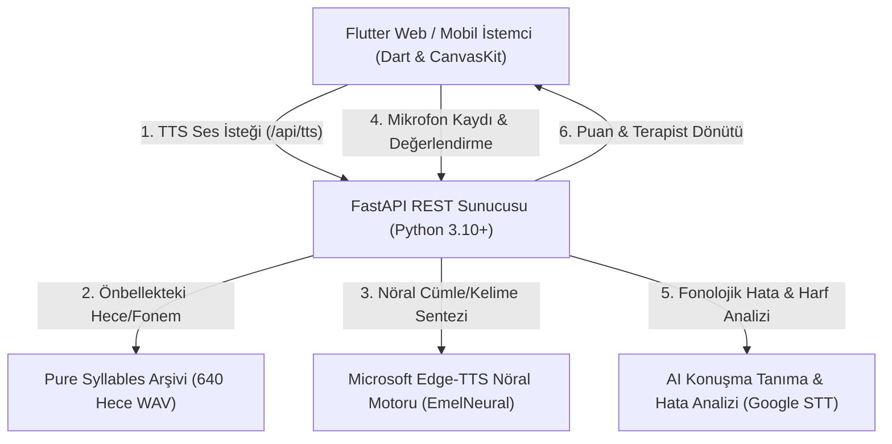

# 🎙️ Ses Yolunda Eğlence
### Konuşma Sesi Bozuklukları İçin Yapay Zeka Destekli ve Oyunlaştırılmış Terapi Platformu
**Yazılım Mühendisliği Bitirme Projesi (Graduation Project)**

[](https://flutter.dev)
[](https://fastapi.tiangolo.com)
[](https://python.org)
[-success)](#-testler-ve-doğrulama)
[](#)

---

## 📖 Proje Hakkında
**Ses Yolunda Eğlence**, çocukluk çağı konuşma sesi bozukluklarının (artikülasyon ve fonolojik bozukluklar) terapisi için geliştirilmiş, yapay zeka destekli, mobil ve web uyumlu bir klinik eğitim platformudur. 

Uygulamanın klinik hiyerarşisi, dil ve konuşma terapisi (DKT) alanının temel kaynaklarından olan **"Heceden Hikayeye Konuşma Sesi Bozuklukları Terapi Alıştırma Kitabı" (Serkan Bengisu ve ark., 2020)** temel alınarak tasarlanmıştır.

### 🌟 Öne Çıkan Özellikler
* **20 Klinik Fonem:** Patlamalı, sürtünmeli, durak-sürtünmeli, genizsi, akıcı ve daralmalı 20 ses aşaması (`/p/`, `/b/`, `/t/`, `/d/`, `/k/`, `/g/`, `/f/`, `/v/`, `/s/`, `/z/`, `/ş/`, `/j/`, `/h/`, `/ç/`, `/c/`, `/m/`, `/n/`, `/l/`, `/r/`, `/y/`).
* **640 Standart Hece:** Her aşamada pedagojik olarak yapılandırılmış 32 hece (8 CV, 8 VC, 8 VCV, 8 CVC). Tepe genlikleri 26.000 seviyesine normalize edilmiş, %100 temiz ve çakışmasız.
* **100% Pikogram Kapsayıcılığı:** 2.765 klinik sözcüğün tamamı gerçek çocuk dostu emojilerle eşleştirilmiştir (0 harf fallback).
* **Canlı Dans Eden 3D Avatarlar:** Subway Surfers tarzı, bacakları ve kolları ritimle hareket eden, kostümleri ve aksesuarları özelleştirilebilen ödül avatarları (`Süper Kaykaycı Can`, `Fütüristik Robo-B`, `Gölge Ninja Kaan` vb.).
* **Yapay Zeka Destekli Konuşma Değerlendirme:** Mikrofondan alınan konuşmayı Google STT (`tr-TR`) ve difflib SequenceMatcher ile analiz ederek artikülasyon hatasını (atlama, yerine koyma, bozma) tespit eden ve anında sesli terapist dönütü veren AI motoru.
* **Klinik Veli ve Terapist Raporu:** Kelime başı, ortası ve sonundaki sesletim doğruluğunu (Initial, Medial, Final Position) grafiklerle raporlama.
* **Çevrimdışı (Offline) CanvasKit:** CDN erişimi olmasa dahi yerel CanvasKit ile 60 FPS hızında çalışan bağımsız Web platformu.
* **Başarı Sertifikası & Çalışma Kağıdı:** Çocuğun adına özel başarı diploması ve yazdırılabilir çalışma kağıtları.

---

## 🏗️ Sistem Mimarisi



---

## 🚀 Kurulum ve Çalıştırma

### 1. Gereksinimler
* Python 3.10 veya üzeri
* Flutter 3.10+ (veya Chrome tarayıcısı)
* Git (isteğe bağlı)

### 2. Python Backend Sunucusunu Başlatma
```bash
# 1. Bağımlılıkları yükleyin
pip install -r requirements.txt

# 2. FastAPI sunucusunu başlatın (Port: 8000)
python -m uvicorn backend.main:app --host 127.0.0.1 --port 8000 --reload
```
> Backend sunucusu `http://127.0.0.1:8000` adresinde çalışacaktır. API belgelerine `http://127.0.0.1:8000/docs` adresinden erişebilirsiniz.

### 3. Flutter Web İstemcisini Başlatma
```bash
# Web sunucusunu başlatın (Port: 8080)
python scripts/serve_web.py
```
> Tarayıcınızda `http://127.0.0.1:8080` adresini açarak uygulamayı hemen deneyimleyebilirsiniz.

---

## 🧪 Testler ve Doğrulama

Proje, yazılım mühendisliği disiplinine uygun olarak hem birim (unit) hem entegrasyon testleriyle donatılmıştır.

### 1. Flutter Klinik Veri & Model Birim Testleri
```bash
cd mobile
flutter test test/sound_groups_unit_test.dart
```
* **Kapsam:** 20 Fonem tamlığı, her aşamada 32 hece kuralı, klinik hikaye doluluğu, pikogram sözlük temizliği.
* **Sonuç:** `4/4 Passed (100% Başarılı)`

### 2. FastAPI Backend Entegrasyon Testleri
```bash
python -m unittest tests/test_backend_api.py
```
* **Kapsam:** Sağlık kontrolü, izole fonem TTS, doğru/hatalı telaffuz analizi, hece dosyaları akustik süre ve tepe genlik kontrolleri.
* **Sonuç:** `5/5 Passed (100% Başarılı)`

### 3. Nihai Adli Proje Doğrulaması (Final Audit)
```bash
python scripts/verify_graduation_project.py
```
* **Sonuç:** `8/8 Kusursuz (OK)`

### 4. Statik Kod Analizi
```bash
flutter analyze mobile
```
* **Sonuç:** `No issues found! (0 Hata / 0 Uyarı)`

---

## 📁 Proje Dizin Yapısı
```
SesYolundaEglence/
├── backend/
│   ├── main.py                  # FastAPI ana sunucusu & AI konuşma analizi
│   ├── pure_syllables/          # 640 saf hece ve 20 fonem WAV arşivi
│   └── requirements.txt         # Backend Python bağımlılıkları
├── mobile/
│   ├── lib/
│   │   ├── data/                # 20 Ses aşaması, klinik heceler ve kelimeler
│   │   ├── models/              # SoundStage, RewardState, StudentProfile modelleri
│   │   ├── screens/             # HomeScreen, SoundPracticeScreen
│   │   ├── services/            # AudioSpeechService, SoundEffectsService
│   │   ├── utils/               # WordPictogramHelper (2.765 emoji sözlüğü)
│   │   └── widgets/             # Canlı 3D avatarlar, mini oyunlar, raporlar
│   ├── test/                    # sound_groups_unit_test.dart
│   └── web/                     # Web CanvasKit şablonu, index.html
├── docs/
│   ├── Bitirme_Projesi_Final_Raporu.docx  # Üniversite resmi teslim raporu (Word)
│   └── Bitirme_Projesi_Final_Raporu.md    # Detaylı mimari ve klinik rapor
├── scripts/                     # Sunucu, yama ve doğrulama araçları
├── tests/                       # test_backend_api.py entegrasyon testleri
├── requirements.txt             # Kök Python bağımlılıkları
└── README.md                    # Proje dokümantasyonu
```

---

## 📚 Akademik Kaynakça
1. **Bengisu, S., ve ark. (2020).** *Heceden Hikayeye Konuşma Sesi Bozuklukları Terapi Alıştırma Kitabı.* Nobel Tıp Kitabevleri.
2. **Topbaş, S. (2006).** *Türkçe Konuşan Çocuklarda Sesletim ve Sesbilgisi Süreçleri.* Türk Psikoloji Dergisi.
3. **Microsoft Edge-TTS (2026).** *Azure Cognitive Services Neural Speech Platform.*
4. **Google Speech-to-Text API (2026).** *Cloud Speech Recognition Documentation.*
