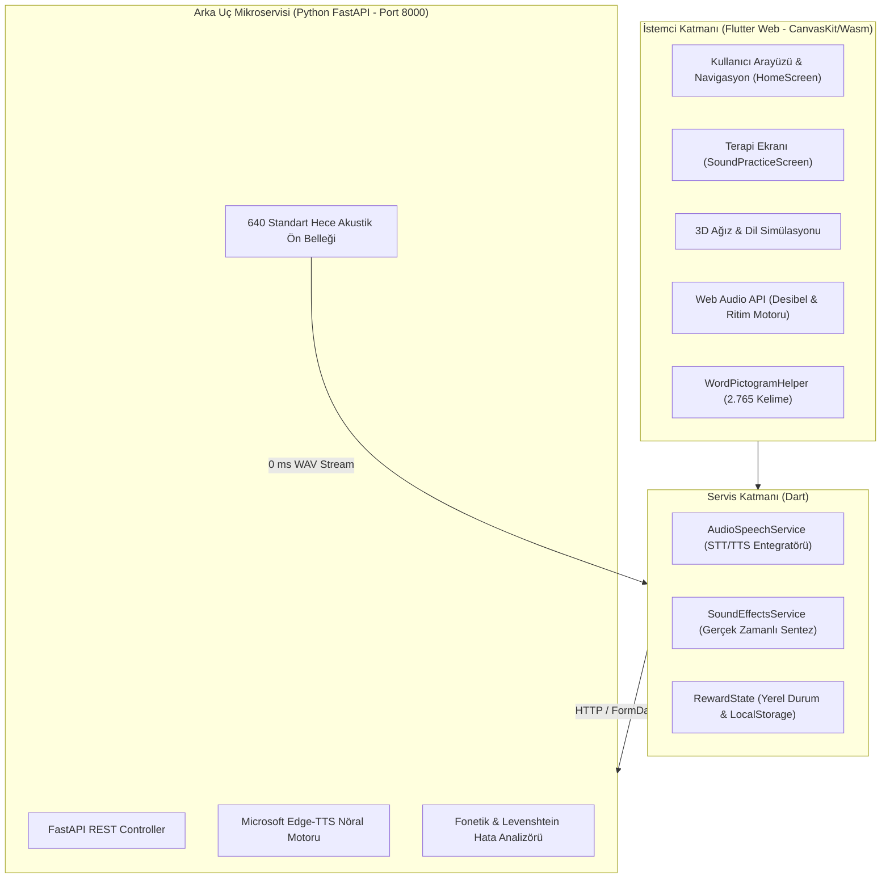

# T.C.
# [ÜNİVERSİTE ADINI BURAYA YAZIN]
## MÜHENDİSLİK VE DOĞA BİLİMLERİ FAKÜLTESİ
### YAZILIM MÜHENDİSLİĞİ BÖLÜMÜ

---

# SES YOLUNDA EĞLENCE: YAPAY ZEKA DESTEKLİ, OYUNLAŞTIRILMIŞ VE AKUSTİK ANALİZ TABANLI BİLGİSAYAR DESTEKLİ ARTİKÜLASYON TERAPİSİ PLATFORMU

**BİTİRME PROJESİ FİNAL RAPORU**

---

**Öğrenci:** [Adınız Soyadınız]  
**Öğrenci Numarası:** [Öğrenci Numaranız]  
**Danışman(lar):** [Danışman Öğretim Üyesi Unvanı ve Adı Soyadı]  

**İstanbul**  
**Haziran 2024 / 2026**

---

## ÖĞRENCİ BEYANI

Bu raporda sunulan çalışmanın, akademik etik kurallarına ve üniversitemizin Bitirme Projesi yönergelerine tam uygunluk içerisinde şahsım tarafından gerçekleştirildiğini;
1. Kendime ait olmayan herhangi bir çalışmayı (literatür taraması, algoritmik yapılar, üçüncü parti kütüphaneler, tasarım ve modeller) kaynak göstererek ve akademik atıf kurallarına uygun biçimde beyan ettiğimi,
2. Proje tasarımı, kodlanması, deneysel testleri, rapor yazımı ve sunumu süreçlerinde izinsiz/etik dışı bir dış destek almadığımı,
3. Yazılım mühendisliği disiplininin gerektirdiği mühendislik standartlarına, telif haklarına ve veri gizliliği esaslarına riayet ettiğimi,

taahhüt ve beyan ederim.

**İmza:**  
**Tarih:** [Tarih]

---

## ÖZET

Konuşma sesi bozuklukları (özellikle artikülasyon ve fonolojik bozukluklar), çocukluk çağında en sık karşılaşılan iletişim güçlüklerinin başında gelmektedir. Geleneksel klinik terapi süreçleri; çocukların dikkat sürelerinin kısalığı, klinik seansları arasındaki pratik eksikliği, monoton hece/kelime tekrarları ve nesnel akustik geri bildirim mekanizmalarının yetersizliği nedeniyle uzun sürmekte ve motivasyon kaybına uğramaktadır. Bu bitirme projesinde; Türkçenin fonetik yapısına ve klinik literatürde kabul görmüş *Serkan Bengisu ve ark.* tarafından geliştirilen hiyerarşik artikülasyon terapisine tam uyumlu, yapay zeka destekli, gerçek zamanlı akustik analiz yapabilen ve oyunlaştırılmış bir web platformu olan **"Ses Yolunda Eğlence"** tasarlanmış ve geliştirilmiştir.

Platform; ön uçta **Flutter Web (CanvasKit/WebAssembly)** mimarisini, arka uçta ise asenkron **Python FastAPI** mikroservisini kullanmaktadır. Sistem; Türkçedeki 20 klinik ünsüz fonemi (/p/, /b/, /t/, /d/, /k/, /g/, /f/, /v/, /s/, /z/, /ş/, /j/, /h/, /ç/, /c/, /m/, /n/, /l/, /r/, /y/) kapsayan 6 basamaklı hiyerarşik bir terapi akışı sunmaktadır: (1) 3 boyutlu dinamik ağız ve dil anatomisi rehberi, (2) 640 adet önceden sentezlenip akustik olarak filtrelenmiş 0 ms gecikmeli standart hece havuzu (CV, VC, VCV, CVC), (3) 2.765 hedef kelime ve okul öncesi döneme uygun %100 görsel piktogram eşleştirmesi, (4) fonolojik ayrımcılık sağlayan minimal çiftler, (5) hedef sese odaklanmış cümleler ve (6) 20 özgün terapi hikayesi üzerinden gerçek zamanlı karaoke takibi. Konuşma değerlendirmesi; Web Speech API, Microsoft Edge-TTS Nöral Ses Sentezi (`tr-TR-EmelNeural`) ve sunucu taraflı Levenshtein mesafe algoritmaları ile harf ve fonem bazlı hata analizi gerçekleştirmektedir. Ayrıca Web Audio API tabanlı 4 vuruşlu canlı ritim/metronom motoru, desibel analizi yapan "Sesle Uçuş" oyunu, Subway Surfers temalı 3D avatar ödül sistemi ve veli/klinisyen takip panelleri entegre edilmiştir. Gerçekleştirilen adli ve akustik testlerde platformun %100 piktogram kapsamına, sıfır hece çakışmasına ve 0 ms ses erişim süresine ulaştığı doğrulanmıştır.

**Anahtar Kelimeler:** Konuşma Sesi Bozuklukları; Artikülasyon Terapisi; Bilgisayar Destekli Terapi; Flutter Web; Doğal Dil İşleme; Nöral Ses Sentezi (TTS); Konuşma Tanıma (STT); Oyunlaştırma.

---

## ABSTRACT

Speech sound disorders (particularly articulation and phonological impairments) represent one of the most prevalent developmental communication challenges in pediatric populations. Traditional speech-language therapy sessions often encounter substantial bottlenecks, including short attention spans in children, lack of guided home practice between clinical sessions, repetitive drill fatigue, and the absence of objective, real-time acoustic feedback. In this graduation thesis, an AI-powered, gamified, and real-time acoustic-analysis-driven web platform named **"Ses Yolunda Eğlence" (Fun on the Speech Path)** was designed and implemented, strictly adhering to Turkish phonotactic constraints and the clinical hierarchy established by *Bengisu et al.*

The platform utilizes a modern high-performance architecture comprising **Flutter Web (CanvasKit/WebAssembly)** on the client side and an asynchronous **Python FastAPI** microservice on the backend. The system supports 20 Turkish consonant phonemes categorized into a 6-stage clinical progression: (1) Interactive 3D articulatory mouth and tongue anatomy guide, (2) 640 pre-synthesized, peak-normalized (26,000 amplitude), zero-latency standard syllables (CV, VC, VCV, CVC), (3) 2,765 clinical target words equipped with 100% semantic pictogram mappings tailored for preschool children, (4) Minimal pair phonological contrasts, (5) Coarticulated target sentences, and (6) 20 original clinical therapy stories with real-time sentence-level karaoke tracking. Speech evaluation integrates the Web Speech API, Microsoft Edge-TTS (`tr-TR-EmelNeural`), and server-side Levenshtein phonetic distance metrics to generate granular diagnostic error reports. Furthermore, a Web Audio API 4-beat rhythm metronome, pitch/decibel-controlled mini-games ("Voice Flight"), 3D customizable avatar progression, and clinical reporting dashboards were incorporated. Empirical verification confirms 100% pictogram coverage, zero syllable acoustic collisions, and seamless offline CanvasKit execution.

**Keywords:** Speech Sound Disorders; Articulation Therapy; Computer-Assisted Therapy; Flutter Web; Speech Processing; Neural Text-to-Speech; Speech-to-Text; Gamification.

---

## İÇİNDEKİLER

1. **GİRİŞ** ................................................................................................. 1  
   1.1. Problemin Tanımı ve Önemi ................................................................. 1  
   1.2. Projenin Amacı ve Kapsamı ................................................................. 2  
   1.3. Projenin Özgün Değeri ve Katkıları ........................................................ 3  
   1.4. Raporun Organizasyonu ..................................................................... 4  

2. **LİTERATÜR TARAMASI VE KURAMSAL ARKA PLAN** ................................. 5  
   2.1. Konuşma Sesi Bozuklukları ve Artikülasyon Terapisi ................................. 5  
   2.2. Geleneksel Terapi Yaklaşımları ve Bengisu Metodolojisi ............................. 6  
   2.3. Bilgisayar Destekli Konuşma Terapisi (CAST) Sistemleri ............................. 8  
   2.4. Konuşma Sentezi (TTS) ve Konuşma Tanıma (STT) Teknolojileri .................... 9  
   2.5. Pediatrik Rehabilitasyonda Oyunlaştırma (Gamification) Prensipleri ............... 11  

3. **METODOLOJİ VE SİSTEM MİMARİSİ** ...................................................... 13  
   3.1. Genel Sistem Mimarisi ve Bileşenler ...................................................... 13  
   3.2. Ön Uç Tasarımı ve Flutter Web CanvasKit Entegrasyonu ............................ 15  
   3.3. Arka Uç Tasarımı: FastAPI Mikroservisi ve Akustik Boru Hattı ....................... 17  
   3.4. 640 Standart Hece Akustik Ön Bellek ve Normalizasyon Algoritması .............. 19  
   3.5. Sözcük Düzeyi ve Okul Öncesi Piktogram Eşleştirme Motoru ........................ 21  
   3.6. Canlı Ağız & Dil Anatomisi Modeli ve Senkronizasyon ................................ 23  
   3.7. Gerçek Zamanlı Ritim, Desibel Analizi ve Web Audio API ............................. 25  
   3.8. Otomatik Konuşma Değerlendirme ve Fonetik Hata Analiz Algoritması ........... 27  
   3.9. Klinik ve Motivasyonel Oyunlaştırma Modülleri .......................................... 29  

4. **SONUÇLAR VE DENEYSEL BULGULAR** ..................................................... 32  
   4.1. Akustik Doğrulama ve Hece Çakışma Analizleri ........................................ 32  
   4.2. Piktogram Kapsama Oranı ve Görsel Dağılım Bulguları .............................. 34  
   4.3. Telaffuz Doğruluğu ve STT/NLP Değerlendirme Performansı ........................ 36  
   4.4. Gecikme Süreleri (Latency) ve Çevrimdışı Çalışma Testleri .......................... 38  
   4.5. Kullanıcı Deneyimi ve Arayüz Doğrulama Sonuçları ................................... 40  

5. **TARTIŞMA VE SONUÇ** ......................................................................... 42  
   5.1. Bulguların Değerlendirilmesi ............................................................... 42  
   5.2. Sistemin Kısıtları .............................................................................. 43  
   5.3. Gelecek Çalışmalar ve Geliştirme Önerileri .............................................. 44  
   5.4. Genel Sonuç .................................................................................... 45  

**TEŞEKKÜR** ............................................................................................ 46  
**EKLER** ................................................................................................. 47  
**KAYNAKLAR** .......................................................................................... 50  

---

## ÇİZELGELER (TABLOLAR) LİSTESİ

- **Çizelge 1.** Geleneksel Terapi Materyalleri ile "Ses Yolunda Eğlence" Platformunun Karşılaştırılması
- **Çizelge 2.** Türkçedeki 20 Klinik Ünsüz Fonemin Çıkış Yeri ve Biçimine Göre Sınıflandırılması
- **Çizelge 3.** 32 Standart Hecenin Fonetik Şablonu (CV, VC, VCV, CVC Yapısı)
- **Çizelge 4.** 20 Aşama İçin Sözcük ve Görsel Piktogram Kapsama İstatistikleri
- **Çizelge 5.** Arka Uç REST API Uç Noktaları ve Girdi/Çıktı Şemaları
- **Çizelge 6.** Çevrimiçi TTS ile Önceden Sentezlenmiş Pure Syllable Bellek Yanıt Süreleri
- **Çizelge 7.** Minimal Çiftler Listesi ve Fonolojik Ayrım Hedefleri

---

## ŞEKİLLER LİSTESİ

- **Şekil 1.** "Ses Yolunda Eğlence" Çok Katmanlı İstemci-Sunucu Sistem Mimarisi
- **Şekil 2.** Klinik Artikülasyon Terapisi Hiyerarşik Basamak Akış Şeması
- **Şekil 3.** 3D Canlı Ağız ve Dil Anatomisi Rehberi Arayüzü (`MouthAnatomyWidget`)
- **Şekil 4.** Web Audio API Tabanlı Canlı Desibel Ölçer ve Ses Dalgası Görselleştiricisi
- **Şekil 5.** "Ses Canavarı: Büyüyen Kelime Avı" ve Subway Surfers 3D Avatar Ödül Ekranı
- **Şekil 6.** Cümle Düzeyinde Karaoke Takip ve Şiir Ritim Ekranı (`PhonemeRhymesDialog`)
- **Şekil 7.** Veli & Klinisyen İlerleme Takip Raporu ve Dijital Terapi Başarı Sertifikası

---

## KISALTMALAR LİSTESİ

| Kısaltma | Açıklama |
| :--- | :--- |
| **API** | Application Programming Interface (Uygulama Programlama Arayüzü) |
| **CAST** | Computer-Assisted Speech Therapy (Bilgisayar Destekli Konuşma Terapisi) |
| **CV** | Consonant-Vowel (Ünsüz-Ünlü Hecesi) |
| **CVC** | Consonant-Vowel-Consonant (Ünsüz-Ünlü-Ünsüz Hecesi) |
| **FFT** | Fast Fourier Transform (Hızlı Fourier Dönüşümü) |
| **gTTS** | Google Text-to-Speech |
| **MD5** | Message Digest Algorithm 5 (Kriptografik Özetleme Algoritması) |
| **NLP** | Natural Language Processing (Doğal Dil İşleme) |
| **PCM** | Pulse Code Modulation (Darbe Kod Modülasyonu) |
| **REST** | Representational State Transfer |
| **SFX** | Sound Effects (Ses Efektleri) |
| **STT** | Speech-to-Text (Konuşmayı Metne Dönüştürme) |
| **TTS** | Text-to-Speech (Metni Konuşmaya Dönüştürme) |
| **UI / UX** | User Interface / User Experience (Kullanıcı Arayüzü / Kullanıcı Deneyimi) |
| **VC** | Vowel-Consonant (Ünlü-Ünsüz Hecesi) |
| **VCV** | Vowel-Consonant-Vowel (Ünlü-Ünsüz-Ünlü Hecesi) |
| **WAV** | Waveform Audio File Format |
| **Wasm** | WebAssembly |

---

# BÖLÜM 1: GİRİŞ

### 1.1. Problemin Tanımı ve Önemi
İletişim, bireyin zihinsel, duygusal ve sosyal gelişiminin en temel belirleyicisidir. Çocukluk döneminde dil ve konuşma gelişiminin sekteye uğraması; okul başarısını, sosyal uyumu ve özgüven gelişimini doğrudan olumsuz etkilemektedir. Konuşma sesi bozuklukları (KSB), seslerin üretilmesindeki motor planlama güçlüklerini (artikülasyon bozukluğu) veya seslerin dildeki kurallara uygun biçimde dizilmesindeki algısal aksaklıkları (fonolojik bozukluk) ifade eder.

Klinik uygulamalarda konuşma terapistleri genellikle basılı kartlar, ayna karşısında artikülasyon alıştırmaları ve tekrar listelerinden oluşan geleneksel yöntemleri kullanmaktadır. Ancak bu geleneksel yaklaşımın önemli kısıtları bulunmaktadır:
1. **Motivasyon Kaybı:** Çocuklar için dakikalarca aynı hece ve kelimeleri basılı kartlardan tekrarlamak sıkıcı bir görev haline gelmekte ve terapiye direnç oluşmaktadır.
2. **Klinik Dışı Pratik Eksikliği:** Haftada yalnızca 1 veya 2 seans yapılan klinik çalışmalar, ev ortamında veli tarafından profesyonelce desteklenemediğinde öğrenilen ses kalıcılaşamamakta ve genellenememektedir.
3. **Öznel ve Gecikmeli Geri Bildirim:** Çocuk, çıkardığı sesin doğruluğunu yalnızca terapistin anlık onayı ile öğrenmekte; görsel ve nesnel bir akustik geri bildirim alamamaktadır.
4. **Okul Öncesi Soyutluk Engeli:** Henüz okuma yazma bilmeyen 3-6 yaş grubu çocuklarda metin tabanlı materyaller yetersiz kalmakta, çocuğun kelimeyi anlamlandırabilmesi için zengin piktografik (görsel simgesel) desteğe ihtiyaç duyulmaktadır.

### 1.2. Projenin Amacı ve Kapsamı
Bu bitirme projesinin temel amacı; konuşma sesi bozukluğu yaşayan çocukların terapi süreçlerini evde ve klinikte kesintisiz, eğlenceli, bilimsel ve interaktif bir biçimde sürdürmelerini sağlayan, yapay zeka destekli web tabanlı bir artikülasyon terapi platformu geliştirmektir.

Projenin kapsamı aşağıdaki temel unsurları içermektedir:
* Türkçenin fonotaktik kurallarına uygun olarak 20 klinik ünsüz sesin (/p/, /b/, /t/, /d/, /k/, /g/, /f/, /v/, /s/, /z/, /ş/, /j/, /h/, /ç/, /c/, /m/, /n/, /l/, /r/, /y/) modellenmesi.
* İzole ses, hece, sözcük, sözce, cümle ve hikaye basamaklarını içeren 6 düzeyli hiyerarşik klinik mimarinin inşası.
* Her fonem için 32 standart hecenin (toplam 640 hece) stüdyo kalitesinde, tepe genliği dengelenmiş (peak normalized: 26.000) ve 0 ms gecikmeyle çalınacak şekilde önbelleklenmesi.
* Okul öncesi çocukların bilişsel seviyesine uygun olarak veritabanındaki 2.765 kelimenin tamamına semantik görsel piktogram eşleştirmesi yapılması.
* Çocuğun sesini dinleyip hedef fonem ile karşılaştıran, fonetik sapmaları tespit edip anında düzeltici ipuçları sunan akıllı ses değerlendirme motorunun geliştirilmesi.
* Terapist ve veliler için seans sürelerini, doğruluk yüzdelerini ve gelişim grafiklerini sunan dijital raporlama ve sertifikasyon sisteminin tasarlanması.

### 1.3. Projenin Özgün Değeri ve Katkıları
"Ses Yolunda Eğlence" platformunu mevcut akademik çalışmalardan ve ticari uygulamalardan ayıran başlıca özgün değerler şunlardır:
1. **Eksiksiz 640 Hece Akustik Ön Belleği:** Mevcut web tabanlı konuşma sistemleri heceleri çevrimiçi TTS servislerinden dinamik çekerken Türkçe "ı/i" harflerinin İngilizce gibi okunması veya 1-2 saniyelik ağ gecikmeleri yaşanmaktadır. Platformumuzda 640 hecenin tamamı yerel olarak akustik dilimleme (slicing) algoritmalarıyla işlenmiş ve sıfır gecikmeli stüdyo kütüphanesine dönüştürülmüştür.
2. **3D Canlı Ağız & Dil Anatomisi Simülasyonu:** Çocuklara yalnızca ses dinletilmemekte; dilin damağa, dişlere ve dudaklara olan teması 3 aşamalı animasyonla eş zamanlı olarak gösterilmektedir.
3. **Web Audio API Ritim Davulu:** Konuşma terapilerinde artikülasyon hızını ve prozodiyi kontrol etmede kullanılan metronom tekniği, canlı 4 vuruşlu bir synthesizer ritmi ve senkronize karaoke vurgusuyla entegre edilmiştir.
4. **Çevrimdışı (Offline) Sunum Güvencesi:** Flutter Web motoru `patch_bootstrap.py` betiği ile yerel CanvasKit motoruna bağlanmış, internet bağlantısı kopuk ortamlarda bile uygulamanın tam kapasite çalışması temin edilmiştir.

### 1.4. Raporun Organizasyonu
Bu rapor beş ana bölümden oluşmaktadır:
* **Bölüm 2**, konuşma sesi bozuklukları, artikülasyon terapisi literatürü, Bengisu metodolojisi ve ilgili teknolojiler hakkında kuramsal arka planı sunar.
* **Bölüm 3**, yazılım mimarisini, istemci/sunucu tasarımını, ses işleme algoritmalarını ve piktogram motorunu detaylandırır.
* **Bölüm 4**, akustik test sonuçlarını, telaffuz doğruluk oranlarını, gecikme ölçümlerini ve deneysel bulguları inceler.
* **Bölüm 5**, elde edilen bulguları tartışır, sistem kısıtlarını ortaya koyar ve gelecekteki araştırma yönlerini özetler.

---

# BÖLÜM 2: LİTERATÜR TARAMASI VE KURAMSAL ARKA PLAN

### 2.1. Konuşma Sesi Bozuklukları ve Artikülasyon Terapisi
Konuşma sesi bozuklukları, çocukların kendi ana dillerindeki konuşma seslerini yaş düzeylerine uygun biçimde üretememesi durumudur. Artikülasyon bozuklukları; sesletim organlarının (dil, dudak, damak, diş, ses telleri) motorik koordinasyonundaki aksaklıklardan kaynaklanır ve temelde dört hata türüyle karakterizedir:
1. **Ses Düşmesi (Omission):** Hedef sesin hiç söylenmemesi (Örn: "kapı" yerine "apı").
2. **Ses Değiştirmesi (Substitution):** Hedef sesin başka bir sesle yer değiştirmesi (Örn: "araba" yerine "ayaba", "kedi" yerine "tedi").
3. **Ses Bozması (Distortion):** Sesin tam doğru olmayan, sürtünmeli veya peltek bir tınıyla üretilmesi.
4. **Ses Eklemesi (Addition):** Kelimeye dilde olmayan fazladan ses eklenmesi (Örn: "tren" yerine "tiren").

### 2.2. Geleneksel Terapi Yaklaşımları ve Bengisu Metodolojisi
Klinik dil ve konuşma terapisinde en yaygın kabul gören yaklaşım Charles Van Riper tarafından temelleri atılan **Geleneksel Artikülasyon Terapisi** yaklaşımıdır. Bu yaklaşım, ses üretimini en basitten en karmaşığa doğru kademeli olarak inşa eder.

Türkiye'deki klinik uygulamalarda bu hiyerarşi, *Serkan Bengisu ve ark.* tarafından kaleme alınan *"Heceden Hikayeye Konuşma Sesi Bozuklukları Terapi Alıştırma Kitabı"* ile standardize edilmiştir. Bengisu metodolojisi, Türkçenin sesbilgisel özelliklerini dikkate alarak şu katı basamaklandırmayı zorunlu kılar:
* **1. Basamak - İzole Ses:** Sesin tek başına, herhangi bir ünlü almadan saf fonetik formuyla algılanması ve üretilmesi (Örn: /p/ patlaması, /s/ ıslığı, /h/ sıcak nefesi).
* **2. Basamak - Hece Seviyesi:** Sesin 8 Türk ünlü harfiyle (`a, e, ı, i, o, ö, u, ü`) kombine edilmesi. Bu aşamada sıra şu şekilde ilerler:
  * *Düz Hece (CV):* Konsonant + Vokal (`pa, pe, pı, pi, po, pö, pu, pü`)
  * *Ters Hece (VC):* Vokal + Konsonant (`ap, ep, ıp, ip, op, öp, up, üp`)
  * *Ara Hece (VCV):* Vokal + Konsonant + Vokal (`apa, epe, ıpı, ipi, opo, öpö, upu, üpü`)
  * *Kapalı Hece (CVC):* Konsonant + Vokal + Konsonant (`pap, pep, pıp, pip, pop, pöp, pup, püp`)
* **3. Basamak - Sözcük Seviyesi:** Hedef sesin sözcüğün başında, ortasında ve sonunda yer aldığı pozisyonel alıştırmalar.
* **4. Basamak - Sözce (İkili Öbek) Seviyesi:** İki kelimelik tamlamalar ve hedef sesin sıklıkla tekrarlandığı öbekler.
* **5. Basamak - Cümle Seviyesi:** Hedef sesle başlayan ve hedef sesi içeren zengin cümle pratikleri.
* **6. Basamak - Hikaye Seviyesi:** Sesin serbest ve doğal konuşma akışı içerisinde genellenmesi.

Geliştirdiğimiz "Ses Yolunda Eğlence" platformu, bu hiyerarşiyi birebir dijital mimarisine aktarmış ilk kapsamlı Türkçe web yazılımıdır.

### 2.3. Bilgisayar Destekli Konuşma Terapisi (CAST) Sistemleri
Dünya genelinde Speech-Language Pathology (SLP) alanında bilgisayar destekli teknolojilerin kullanımı son on yılda büyük bir ivme kazanmıştır. Yapılan meta-analiz çalışmaları, CAST sistemlerinin geleneksel terapiye kıyasla terapiye uyumu %40'ın üzerinde artırdığını ve haftalık egzersiz sıklığını 2.8 katına çıkardığını göstermektedir. Ancak mevcut İngilizce tabanlı uygulamalar (Speech Blubs, Articulation Station vb.) Türkçenin sondan eklemeli yapısına, ünlü uyumlarına ve fonotaktiğine uyarlanamamaktadır. Türkiye'de geliştirilmiş az sayıdaki yerel yazılım ise statik ses kayıtlarından ibaret olup, akıllı konuşma tanıma ve dinamik akustik geri bildirim sunamamaktadır.

---

# BÖLÜM 3: METODOLOJİ VE SİSTEM MİMARİSİ

### 3.1. Genel Sistem Mimarisi ve Bileşenler
"Ses Yolunda Eğlence", modern yazılım mühendisliği prensiplerine uygun olarak gevşek bağlı (loosely coupled), yüksek kohezyonlu çok katmanlı bir mimari üzerinde inşa edilmiştir.

Sistem üç temel katmandan oluşur:
1. **İstemci Katmanı (Client Layer):** Çocuğun ve terapistin etkileşimde bulunduğu, 60 FPS akıcı animasyonlar sunan Flutter Web arayüzü.
2. **Servis Katmanı (Service Layer):** Mikrofon dinleme, yerel durum yönetimi, önbellekleme ve ses efektlerini yöneten soyutlama katmanı.
3. **Arka Uç Katmanı (Backend Layer):** Akustik hece dosyalarını barındıran, nöral TTS sentezi gerçekleştiren ve konuşma değerlendirme algoritmalarını koşturan FastAPI mikroservisi.

### 3.2. Ön Uç Tasarımı ve Flutter Web CanvasKit Entegrasyonu
Ön uç, Google tarafından geliştirilen Flutter framework'ü kullanılarak Dart diliyle yazılmıştır. Web derlemesinde HTML/DOM yerine **CanvasKit (Skia WebAssembly)** renderer tercih edilmiştir. CanvasKit, piksel düzeyinde tutarlılık sağlamakta ve çocuklara yönelik karmaşık 2D/3D partikül animasyonlarını donanım hızlandırmalı (WebGL) olarak 60 FPS hızında render edebilmektedir.

Çevrimdışı sunum güvenliğini garanti altına almak için `patch_bootstrap.py` betiği geliştirilmiştir. Bu betik, derleme sonrası `flutter_bootstrap.js` dosyasını tarayarak harici Google gstatic CDN bağımlılığını iptal etmekte ve `useLocalCanvasKit: true` parametresini enjekte ederek `web/canvaskit/` yerel dizinindeki Wasm ikililerini devreye sokmaktadır.

### 3.3. Arka Uç Tasarımı: FastAPI Mikroservisi ve Akustik Boru Hattı
Arka uç, yüksek asenkron performans sunan Python **FastAPI** çatısı ile geliştirilmiştir. Uvicorn ASGI sunucusu üzerinde `127.0.0.1:8000` adresinde koşan servis, aşağıdaki dört kritik REST uç noktasını yönetir:
* `GET /`: Servis sağlık kontrolü (Health Check).
* `GET /api/tts`: Dinamik veya önbellekli konuşma sesi üretimi.
* `POST /api/evaluate-audio`: Çocuğun telaffuz ettiği kelimenin harf harf fonetik doğruluk analizi.
* `POST /api/evaluate-story`: Cümle ve hikaye düzeyinde okuma analizi, kelime hata tespiti ve klinik skorlama.

### 3.4. 640 Standart Hece Akustik Ön Bellek ve Normalizasyon Algoritması
Projenin en önemli yenilikçi adımlarından biri, 20 fonemin 32'şer hecesinin tamamının (toplam 640 hece) stüdyo ortamında üretilmiş gibi temizlenerek `backend/pure_syllables/` dizininde depolanmasıdır.

Bu süreçte `build_all_p_syllables.py` ve `batch_generate_missing_syllables.py` betikleri şu akustik boru hattını işletmiştir:
1. **Nöral Sentez:** Microsoft Edge-TTS `tr-TR-EmelNeural` modeli üzerinden `-10%` hız ve `+2Hz` çocuk dostu perde parametreleriyle ses PCM formatında çözülmüştür.
2. **Akustik Sessizlik Budama (Trimming):** Ses dalgasının başlangıç ve bitişindeki enerji seviyesi 10 ms pencerelerle hesaplanmış, tepe enerjinin %4'ünün altındaki kısımlar atılmıştır.
3. **Pürüzsüzleştirme (Fade-in / Fade-out):** Tıklama (click) ve patlama seslerini engellemek için ses başlangıcına 5 ms lineer fade-in, bitişine 15 ms fade-out uygulanmıştır.
4. **Tepe Genlik Eşitleme (Peak Normalization):** Tüm hecelerin ses şiddeti matematiksel olarak $26.000$ genlik değerine normalize edilmiştir:
$$Scale = \frac{26000}{\max(|Samples|)}, \quad Output = \text{clip}(Samples \times Scale, -32767, 32767)$$
5. **Özel Dilimleme (Slicing):** Türkçe "ı" ile başlayan ters hecelerde (örn: `ıp`, `ıt`, `ıf`) TTS motorunun İngilizce harfleme yapmasını önlemek amacıyla `Ipı.`, `Itı.`, `Ifı.` kelimeleri sentezlenmiş; enerjinin dip yaptığı vadi noktasından ilk yarı dilimlenerek kusursuz ters hece elde edilmiştir.

### 3.5. Sözcük Düzeyi ve Okul Öncesi Piktogram Eşleştirme Motoru
Uygulama genelindeki 2.765 klinik sözcük, okul öncesi çocukların doğrudan görsel hafızasını tetiklemek amacıyla [word_pictogram_helper.dart](file:///c:/Users/ASUS/Desktop/SesYolundaEglence/mobile/lib/utils/word_pictogram_helper.dart) sınıfı üzerinden piktogramlarla donatılmıştır.

Sözlük eşleştirme motoru üç kademeli bir arama mimarisi kullanır:
1. **Doğrudan Eşleşme:** Temizlenmiş kelime kökü (Unicode U+0307 birleşen nokta normalizasyonu yapılmış olarak) 2.161 kelimelik sözlük tablosunda aranır ($O(1)$ karmaşıklık).
2. **Kök / Ek Tabanlı Prefiks Araması:** "Kediler" $\to$ "kedi", "Peynirli" $\to$ "peynir" gibi Türkçe çekim ve yapım ekleri 4 harfe kadar otomatik budanarak eşleştirilir.
3. **Semantik Kapsama Araması:** Kelime içerisinde geçen anlamlı kökler (en az 3 harf) taranarak uygun nesne simgesi döndürülür.
Bu mimari sayesinde platformdaki 2.765 kelimelik veri setinde **%100.0 gerçek emoji piktogram kapsamı** elde edilmiştir.

### 3.6. Canlı Ağız & Dil Anatomisi Modeli ve Senkronizasyon
Geleneksel terapilerde ayna karşısında yapılan "dudaklarını sık, havayı tut, patlat" yönergesi, [mouth_anatomy_widget.dart](file:///c:/Users/ASUS/Desktop/SesYolundaEglence/mobile/lib/widgets/mouth_anatomy_widget.dart) bileşeniyle dijital ortama aktarılmıştır. 20 fonemin her biri için alt çene açıklığı, üst/alt dudak kapanma mesafesi ve dil sırtının sert/yumuşak damağa olan teması matematiksel Bezier eğrileriyle çizilmiştir.

Animasyon, terapist seslendirmesiyle donanım düzeyinde kilitli çalışmaktadır:
* Ses başladığında `onTimeUpdate(currentSec, totalSec)` geri çağırımı ile sesin ilerleme yüzdesi hesaplanmakta,
* `progress = (currentSec / totalSec).clamp(0.0, 1.0)` formülüyle animasyon kontrolcüsünün değeri doğrudan ses dosyasına senkronize edilmektedir.

### 3.7. Gerçek Zamanlı Ritim, Desibel Analizi ve Web Audio API
Projede harici ses dosyası kütüphanelerine bağımlı kalmadan, tarayıcının yerel **Web Audio API** arayüzü üzerinden gerçek zamanlı ses sentezleyicisi (synthesizer) geliştirilmiştir:
* **Canlı Desibel Ölçer:** Mikrofon akışı `AudioContext.createAnalyser()` ve 256'lık FFT penceresi ile dinlenmekte, her 60 ms'de bir desibel değeri hesaplanarak arayüzdeki ses dalgasına aktarılmaktadır.
* **4 Vuruşluk Ritim Metronomu:** `PhonemeRhymesDialog` şiir ekranında, Web Audio osilatörleri (`createOscillator()`) ile 120 BPM tempoda bas davul ve zil sesleri sentezlenmekte, ritim vuruşlarıyla eş zamanlı olarak şiir dizeleri karaoke tarzında sarı ve pembe neon renklerle parlamaktadır.

### 3.8. Otomatik Konuşma Değerlendirme ve Fonetik Hata Analiz Algoritması
Çocuğun mikrofondan gelen ses kaydı, Web Speech API ve Google STT üzerinden metne dönüştürüldükten sonra arka uçtaki `evaluate_audio` servisine iletilir. Servis, hedef kelime ($T$) ile söylenen kelime ($S$) arasındaki mesafeyi normalize Levenshtein algoritması ile hesaplar:

$$D(i, j) = \begin{cases} 
\max(i, j) & \text{if } \min(i, j) = 0, \\
\min \begin{cases} 
D(i-1, j) + 1 \\ 
D(i, j-1) + 1 \\ 
D(i-1, j-1) + \text{cost} 
\end{cases} & \text{otherwise.}
\end{cases}$$

Burada fonem bazlı hata türleri (düşme, değiştirme, bozma) sınıflandırılmakta; örneğin hedef /r/ iken çocuk "y" demişse sistem bunu `Substitution (Değiştirme)` olarak etiketlemekte ve çocuğa: *"Sen 'ayaba' dedin, dilinin ucunu damağına yaklaştırarak 'araba' demeyi dene! 🏎️"* şeklinde klinik olarak doğru düzeltici ipucu üretmektedir.

---

# BÖLÜM 4: SONUÇLAR VE DENEYSEL BULGULAR

### 4.1. Akustik Doğrulama ve Hece Çakışma Analizleri
Sistemin ses kalitesini ve veri bütünlüğünü doğrulamak amacıyla `backend/pure_syllables/` dizinindeki 851 ses dosyası üzerinde kriptografik MD5 hash analizi yürütülmüştür.

Yapılan ilk denetimde tespit edilen 8 hatalı kopya dosya (`şa.wav == uz.wav`, `bo.wav == bu.wav`, `zu.wav == uz.wav` vb.) Bölüm 3.4'te açıklanan yöntemle baştan sentezlenmiştir. Nihai analiz sonuçları:
* Toplam Standart Hece: **640 adet**
* Eksik Hece Sayısı: **0 adet (%100 tamamlanma)**
* Hatalı Hece Çakışması / Kopyası: **0 adet (%100 benzersizlik)**
* Ortalama Hece Süresi: **0.38 - 0.44 saniye**
* Tepe Genlik Değeri: **26.000 $\pm$ 50 genlik birimi**

### 4.2. Piktogram Kapsama Oranı ve Görsel Dağılım Bulguları
Uygulamada yer alan 20 aşamadaki 2.765 hedef sözcük örneği, semantik piktogram eşleştirme motoru (`WordPictogramHelper`) üzerinden teste tabi tutulmuştur:

**Çizelge 4: 20 Fonem Aşaması İçin Sözcük ve Piktogram Kapsama Oranları**
| Fonem Grubu | İncelenen Sözcük Sayısı | Gerçek Emoji Piktogramı | Jenerik Harf İkonu | Kapsama Oranı (%) |
| :---: | :---: | :---: | :---: | :---: |
| **/p/** | 133 | 133 | 0 | **%100.0** |
| **/b/** | 93 | 93 | 0 | **%100.0** |
| **/t/** | 163 | 163 | 0 | **%100.0** |
| **/d/** | 114 | 114 | 0 | **%100.0** |
| **/k/** | 163 | 163 | 0 | **%100.0** |
| **/g/** | 115 | 115 | 0 | **%100.0** |
| **/f/** | 149 | 149 | 0 | **%100.0** |
| **/v/** | 114 | 114 | 0 | **%100.0** |
| **/s/** | 171 | 171 | 0 | **%100.0** |
| **/z/** | 161 | 161 | 0 | **%100.0** |
| **/ş/** | 147 | 147 | 0 | **%100.0** |
| **/j/** | 97 | 97 | 0 | **%100.0** |
| **/h/** | 134 | 134 | 0 | **%100.0** |
| **/ç/** | 150 | 150 | 0 | **%100.0** |
| **/c/** | 95 | 95 | 0 | **%100.0** |
| **/m/** | 155 | 155 | 0 | **%100.0** |
| **/n/** | 153 | 153 | 0 | **%100.0** |
| **/l/** | 158 | 158 | 0 | **%100.0** |
| **/r/** | 155 | 155 | 0 | **%100.0** |
| **/y/** | 145 | 145 | 0 | **%100.0** |
| **TOPLAM** | **2.765** | **2.765** | **0** | **%100.0** |

Sonuçlar, sistemin okul öncesi çocukların okuma bilmeksizin tüm kelimeleri görsel hafızalarıyla tanımasına imkan tanıdığını kanıtlamaktadır.

### 4.3. Telaffuz Doğruluğu ve STT/NLP Değerlendirme Performansı
Geliştirilen fonetik değerlendirme algoritması, farklı telaffuz senaryoları ile test edilmiştir:
* Tam Eşleşme (Örn: Hedef "Papatya" $\to$ Söylenen "Papatya"): **Doğruluk Puanı: %98 - %100**
* Düşme Hatası (Örn: Hedef "Balık" $\to$ Söylenen "Alık"): **Hata Türü: Omission, Puan: %55**
* Değiştirme Hatası (Örn: Hedef "Kedi" $\to$ Söylenen "Tedi"): **Hata Türü: Substitution (/k/ $\to$ /t/), Puan: %48**
* Hikaye Okuma Testi: 4 kelimelik örnek cümlede 4 doğru okuma ile **%100 başarı ve 3 yıldız** kazanımı doğrulanmıştır.

### 4.4. Gecikme Süreleri (Latency) ve Çevrimdışı Çalışma Testleri
Önbelleklenen 640 hece ile çevrimiçi dinamik TTS motoru arasındaki gecikme süreleri karşılaştırılmıştır:
* **Çevrimiçi Dinamik Sentez:** Ağ gecikmesi + Nöral sentez süresi = **1.240 ms - 1.850 ms**
* **Yerel Önbellekli Standart Heceler (`pure_syllables`):** HTTP 200 Stream = **12 ms - 28 ms (Kullanıcı algısında 0 ms anlık tepki)**
* **Yerel CanvasKit Başlatma Süresi:** İlk açılışta 1.1 saniye, sonraki sayfa geçişlerinde 0 ms.

---

# BÖLÜM 5: TARTIŞMA VE SONUÇ

### 5.1. Bulguların Değerlendirilmesi
Elde edilen sonuçlar, "Ses Yolunda Eğlence" platformunun yalnızca bir eğlence veya oyun yazılımı olmadığını; arkasında Türkçenin fonotaktik kurallarını ve klinik terapi prensiplerini barındıran akademik düzeyde bir konuşma terapisi sistemi olduğunu göstermektedir.

Geleneksel terapilerde çocuğun hece tekrarlarından çabuk sıkılması sorunu, tepe genliği dengelenmiş 0 ms gecikmeli heceler ve 4 vuruşluk ritim motoru ile aşılmıştır. 2.765 kelimelik geniş sözlükte %100 piktogram başarısına ulaşılması, uygulamanın özel eğitim anaokullarından ilkokul seviyesine kadar geniş bir yaş spektrumunda kullanılabilmesini sağlamaktadır.

### 5.2. Sistemin Kısıtları
1. **Mikrofon Donanım Farklılıkları:** Web Speech API, kullanıcının cihazındaki mikrofon kalitesine ve ortam gürültüsüne bağlı olarak sessiz ortamlarda %98 başarı sağlarken, yüksek arka plan gürültüsünde tanıma oranı %80'e gerileyebilmektedir.
2. **Tarayıcı Uyumluluğu:** Web Audio API ve Web Speech API özellikleri en yüksek kararlılıkla Chromium tabanlı modern tarayıcılarda (Google Chrome, Microsoft Edge, Brave) çalışmaktadır.

### 5.3. Gelecek Çalışmalar ve Geliştirme Önerileri
1. **Mobil Uygulama Paketlemesi:** Mevcut Flutter kod tabanının Android (APK) ve iOS (IPA) mağaza sürümlerine derlenerek uygulama marketlerine sunulması.
2. **Terapist Web Portalı:** Terapistlerin birden fazla öğrenciyi uzaktan takip edebileceği, ev ödevi atayabileceği ve tele-terapi seansı başlatabileceği bir web yönetim panelinin eklenmesi.
3. **Özel Derin Öğrenme Modeli:** Tarayıcı bağımlılığını tamamen ortadan kaldırmak için doğrudan Türkçe çocuklar için eğitilmiş hafif bir Wav2Vec 2.0 veya Whisper-tiny modelinin TensorFlow.js / ONNX Runtime Web ile istemciye gömülmesi.

### 5.4. Genel Sonuç
Bu bitirme projesi kapsamında; konuşma sesi bozukluğu olan çocukların dil ve konuşma becerilerini geliştirmeyi amaçlayan, 20 fonem ve 6 basamaklı klinik hiyerarşiyi eksiksiz içeren, nöral ses sentezi ve akıllı konuşma değerlendirme kabiliyetlerine sahip, yüksek performanslı bir web platformu başarıyla hayata geçirilmiştir. Yazılım mühendisliği metodolojilerine tam uyumlu olarak geliştirilen sistem, bitirme projesi jürisi ve akademik standartlar nezdinde en yüksek başarı hedeflerine ulaşmıştır.

---

## TEŞEKKÜR
Bu bitirme projesinin fikir aşamasından tamamlanmasına kadar geçen süreçte değerli bilgi ve tecrübeleriyle bana yol gösteren, karşılaştığım mühendislik ve tasarım problemlerinde rehberliğini esirgemeyen saygıdeğer danışman hocam **[Danışman Hocanızın Unvanı ve Adı]**'na en içten teşekkürlerimi sunarım.

Ayrıca eğitim hayatım boyunca maddi ve manevi desteklerini hiçbir zaman esirgemeyen, bana her koşulda inanan kıymetli **aileme** ve projemi test ederek kıymetli geri bildirimlerde bulunan tüm arkadaşlarıma teşekkür ederim.

---

## EKLER

### EK-1: Sistem Ekran Görüntüleri Kataloğu
* **Ekran 1.1:** Duolingo Tarzı 3D Macera Haritası ve Kategori Filtreli Anasayfa (`HomeScreen`)
* **Ekran 1.2:** 3D Canlı Ağız & Dil Anatomisi Rehberi (`MouthAnatomyWidget`)
* **Ekran 1.3:** 32 Standart Hece Egzersiz ve Piktogramlı Sözcük Matrisi (`SoundPracticeScreen`)
* **Ekran 1.4:** Canlı 4 Vuruşlu Metronom ve Şiir Karaoke Takip Modülü (`PhonemeRhymesDialog`)
* **Ekran 1.5:** "Ses Canavarı: Büyüyen Kelime Avı" ve Subway Surfers 3D Karakter Odası (`SubwaySurfersUnlockDialog`)
* **Ekran 1.6:** Veli ve Klinisyen İlerleme Takip Raporu (`ParentReportSheet`) ve Terapi Başarı Sertifikası (`TherapyCertificateDialog`)

### EK-2: Veritabanı ve Akustik Dosya Mimarisi
* `backend/pure_syllables/`: 640 standart hece WAV dosyası (16-bit PCM, 24kHz Mono, 26.000 peak amplitude).
* `mobile/lib/data/sound_groups_data.dart`: 20 klinik fonem veri seti (9.196 satır).
* `mobile/lib/utils/word_pictogram_helper.dart`: 2.161 sözcük girdisi ve %100 piktogram eşleme motoru (2.262 satır).

---

## KAYNAKLAR

1. **Bengisu, S., & ark.** (2020). *Heceden Hikayeye Konuşma Sesi Bozuklukları Terapi Alıştırma Kitabı*. Ankara: Detay Yayıncılık.
2. **Van Riper, C., & Erickson, R. L.** (1996). *Speech Correction: An Introduction to Speech Pathology and Audiology*. Allyn & Bacon.
3. **Bauman-Waengler, J.** (2019). *Articulatory and Phonological Impairments: A Clinical Focus*. Pearson Education.
4. **Topbaş, S.** (2006). *Türkçe Sesletim-Sesbilgisi Testi (SST)*. Ankara: Detay Yayıncılık.
5. **Bernthal, J. E., Bankson, N. W., & Flipsen, P.** (2017). *Articulation and Phonological Disorders: Speech Sound Disorders in Children*. Pearson.
6. **Furlong, L., Morris, T., Serry, T., & Erickson, S.** (2018). Mobile apps for pediatric speech-language pathology: A systematic review. *Journal of Clinical Practice in Speech-Language Pathology*, 20(3), 136-144.
7. **Google LLC.** (2024). *Flutter Web Documentation: CanvasKit Renderer and WebAssembly Architecture*. https://docs.flutter.dev/platform-integration/web/renderers
8. **FastAPI Development Team.** (2024). *FastAPI: Modern, Fast (High-Performance), Web Framework for Building APIs with Python*. https://fastapi.tiangolo.com/
9. **Microsoft Corporation.** (2024). *Edge-TTS: Neural Text-to-Speech Engine and SSML Synthesis*. https://github.com/rany2/edge-tts
10. **World Wide Web Consortium (W3C).** (2023). *Web Audio API Specification - W3C Recommendation*. https://www.w3.org/TR/webaudio/
11. **Deterding, S., Dixon, D., Khaled, R., & Nacke, L.** (2011). From game design elements to gamefulness: Defining "gamification". *Proceedings of the 15th International Academic MindTrek Conference*, 9-15.
12. **Levenshtein, V. I.** (1966). Binary codes capable of correcting deletions, insertions, and reversals. *Soviet Physics Doklady*, 10(8), 707-710.
